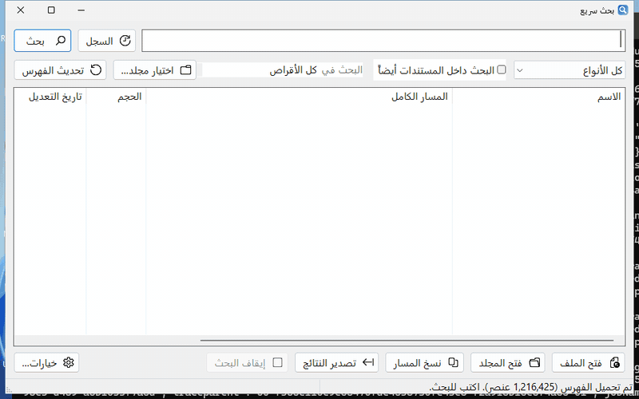
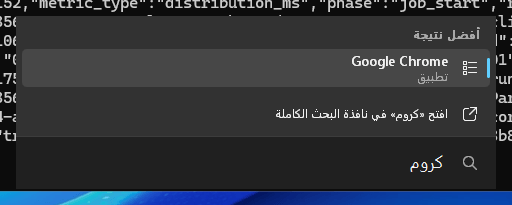
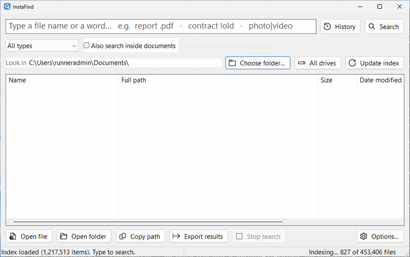
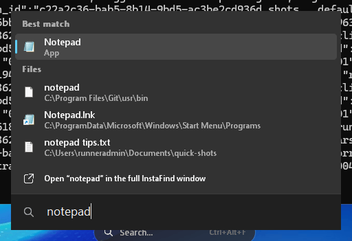

<div dir="rtl">

<p align="center"></p>

<h1 align="center">InstaFind — بحث سريع</h1>

<p align="center"><b>أسرع طريقة لإيجاد أي ملف على ويندوز، بالعربية والإنجليزية، وحتى داخل المستندات.</b><br><b dir="ltr">Find any file on Windows as you type, in Arabic or English, even inside documents.</b></p>

<p align="center">
<a href="https://github.com/sarmadiq9090-coder/arabic-file-search/releases/latest"></a>
<a href="https://github.com/sarmadiq9090-coder/arabic-file-search/releases"></a>
<a href="https://github.com/sarmadiq9090-coder/arabic-file-search/actions/workflows/build.yml"></a>
</p>

<p align="center">
<a href="https://github.com/sarmadiq9090-coder/arabic-file-search/releases/latest/download/bahth.exe"><b>⬇ تنزيل bahth.exe · Download</b></a><br>
<a href="https://fastkiwi.app/arabic-file-search/">الموقع · Website</a> · <a href="#العربية">العربية</a> · <a href="#english">English</a> · <a href="CHANGELOG.md">سجل التغييرات · Changelog</a>
</p>

<table align="center"><tr>
<td align="center">🌐 <b>عربي و English و38 لغة أخرى</b><br>الواجهة تتبع لغة ويندوز، وتُغيَّر في أي وقت من «الإعدادات ← اللغة»</td>
<td align="center" dir="ltr">🌐 <b>English, Arabic and 38 more languages</b><br>The interface follows Windows, and you can switch any time in Settings → Language</td>
</tr></table>

<p align="center">

</p>

## العربية

برنامج ويندوز مجاني مكتوب بلغة Rust. يفهرس كل أقراصك مرة واحدة ثم يُظهر النتائج أثناء الكتابة، حتى مع أكثر من مليون ملف. يفهم العربية كما تُكتب فعلاً: «احمد» تجد «أحمد»، و«التقرير» تجد «تقرير.pdf»، و`hgjrvdv` المكتوبة بلوحة المفاتيح الخطأ تجد «التقرير».

## التنزيل والتشغيل

1. نزّل [`bahth.exe`](https://github.com/sarmadiq9090-coder/arabic-file-search/releases/latest/download/bahth.exe) من [أحدث إصدار](https://github.com/sarmadiq9090-coder/arabic-file-search/releases/latest). ملف واحد، لا يحتاج تثبيتاً.
   - لأجهزة ARM64 (مثل Snapdragon) نزّل [`bahth-arm64.exe`](https://github.com/sarmadiq9090-coder/arabic-file-search/releases/latest/download/bahth-arm64.exe)، ولويندوز 32 بت نزّل [`bahth-x86.exe`](https://github.com/sarmadiq9090-coder/arabic-file-search/releases/latest/download/bahth-x86.exe). كل نسخة تحدّث نفسها بنسختها.
2. شغّله. إن شغّلته من مجلد التنزيلات يعرض عليك مرة واحدة نقل نفسه إلى `%LOCALAPPDATA%\Programs\InstaFind\` (هذا المسار تبحث فيه إضافات `integrations/`، ومعه `Programs\Bahth\` القديم)، أو ضعه أنت في مجلد دائم.
3. إن ظهر تحذير SmartScreen لأن الملف غير موقّع رقمياً: «مزيد من المعلومات» ← «تشغيل على أي حال».

أو ثبّته بأمر واحد عبر [Scoop](https://scoop.sh):

```powershell
scoop bucket add instafind https://github.com/sarmadiq9090-coder/arabic-file-search
scoop install instafind
```

أول تشغيل يفهرس الأقراص في الخلفية (دقيقة أو أكثر حسب عدد الملفات)، وبعدها يفتح البرنامج فوراً ويبقى الفهرس محدَّثاً وحده عند إضافة الملفات أو حذفها أو إعادة تسميتها.

- **التحديث تلقائي**: يتحقق البرنامج مرة يومياً من GitHub ويعرض تثبيت الإصدار الجديد بنقرة ثم يعيد التشغيل، ويمكن التحقق يدوياً من «الإعدادات ← التحديثات والمساعدة ← التحقق من التحديثات…». من لديه 0.3.1 أو أحدث يصله كل تحديث وحده.
- **المتطلبات**: ويندوز 10 أو 11، بنسخ 64 بت وARM64 و32 بت (Rust لم تعد تدعم الأقدم). شكل البرنامج يحتاج مكوّن WebView2 من Microsoft (موجود في ويندوز 11 وأغلب أجهزة ويندوز 10)؛ إن لم يكن موجوداً يعمل البرنامج بالشكل البسيط ويعرض رابط تنزيله المجاني. البحث داخل الصور يحتاج حزمة اللغة العربية في ويندوز لقراءة النص العربي.
- **الخصوصية**: ملفاتك وفهرسها يبقيان على جهازك، ولا يجمع البرنامج أي بيانات استخدام. الاتصالان الوحيدان بالإنترنت هما التحقق من التحديثات على GitHub (نسخة Microsoft Store يحدّثها المتجر فلا تتحقق)، وتنزيل أسعار صرف العملات لتحويل العملات (من open.er-api.com، مرة كل 12 ساعة تقريباً)، والبحث من الهاتف مطفأ ما لم تشغّله، والملاحظات وتقارير الأخطاء لا تُرسل إلا حين تضغط أنت (انظر [الملاحظات والبلاغات](#الملاحظات-والبلاغات)).
- **بيانات البرنامج** في `%LOCALAPPDATA%\BahthSari\` (الفهرس والسجل والإعدادات)، وتفضيلاته في `HKCU\Software\BahthSari`. لإزالته: أطفئ «التشغيل مع ويندوز» من «الإعدادات ← التشغيل»، ثم احذف `bahth.exe` وذلك المجلد.

## السرعة

قِسناها على جهاز ويندوز حقيقي في GitHub Actions (Windows Server 2025، فهرس فيه 1.2 مليون ملف، أقل وأكثر وقت في أربع تجارب)، بالبحث في اسم الملف على القرص كله:

| البحث عن | InstaFind | `dir /s` في cmd | `Get-ChildItem -Recurse` في PowerShell |
|---|---:|---:|---:|
| `report` | **1 ثانية** | 73 إلى 108 ثوانٍ | 29 إلى 51 ثانية |
| `احمد` (والملفات اسمها «أحمد») | **1 ثانية**، وجد الملفين | 19 إلى 33 ثانية، لم يجد شيئاً | 29 إلى 50 ثانية، لم يجد شيئاً |

الثانية في عمود InstaFind تشمل تشغيل البرنامج من سطر الأوامر وقراءة الفهرس من القرص. داخل نافذة البرنامج المفتوحة يظهر الجواب أثناء الكتابة في أجزاء من الثانية (شريط الحالة في العرض أعلاه يقول 15 إلى 34 ملي ثانية). خدمة فهرسة ويندوز غير موجودة على ذلك الجهاز، وهي أصلاً لا تفهرس إلا مجلدات المستخدم ولا تساوي بين «احمد» و«أحمد». يعيد [`ci/bench.ps1`](ci/bench.ps1) القياس، والنتائج الخام في [`docs/media/bench.md`](docs/media/bench.md).

## المميزات

### جديد في 1.0
- **شكل جديد للبرنامج** صار شكله الوحيد: خانة البحث وزر «داخل المستندات» والنتائج والمعاينة في نافذة واحدة، وأهم الخيارات في «الإعدادات» (Ctrl+,)، والباقي في «الإعدادات ← المزيد ← فتح قائمة الخيارات…». إن تعذّر تشغيل WebView2 يعمل البرنامج بالشكل البسيط في تلك المرة فقط ويقول السبب.
- **38 لغة أخرى للواجهة** إلى جانب العربية والإنجليزية، بترجمة آلية مكتوب ذلك بجانبها في «الإعدادات ← اللغة».
- **البحث داخل المستندات أسرع بكثير**: فهرس لكلمات كل مستند، فيقرأ البحث ما قد يطابق فقط وبالنتائج نفسها (في اختبار على 300 ألف مستند: 0.2 إلى 1.1 ثانية بدل 7 إلى 32 ثانية).
- **فهرسة أسرع وأخف**: بناء الفهرس الأول أسرع، والقرص الذي توصله والبرنامج يعمل يُفهرس وحده، والصور لا يُعاد قراءتها مع كل إصدار.
- **بحث بلغات وكتابات أكثر**: حروف الكردية والفارسية والأردية، واللاتينية بلا علامات («cafe» تجد «Café»)، ولوحات مفاتيح أخرى مثبّتة في ويندوز، وكتابات الهمزة («مسئول» و«مسؤول» و«مسوول»).
- **ذاكرة ثابتة**: حفظ واحد للفهرس في كل مرة، وحدود لكل قوائم الانتظار، وحارس للذاكرة، والشكل الجديد لا يحجز ذاكرة وهو مخفي بجانب الساعة.
- **تحديث آمن**: بعد التحديث تعمل نسخة واحدة دائماً، والإصدار الذي لا يبدأ يُعاد السابق مكانه، وتشغيل إصدار أحدث بينما القديم يعمل يستبدل القديم.
- **«كيف أبحث؟»** (F1) بأمثلة تنقر عليها، و**«الإبلاغ عن مشكلة…»** بالبريد أو عبر GitHub بضغطتك فقط، وزر **«التحقق من التحديثات…»** في الإعدادات، و**مفتاح آخر** إن كان Ctrl+Alt+F مستعملاً، و**رمز QR** للبحث من الهاتف.
- **لا تنزيل من OneDrive دون إذنك**: الملفات الموجودة على السحابة فقط لا يقرأ البرنامج محتواها إلا إذا فعّلت ذلك.
- القائمة الكاملة في [سجل التغييرات](CHANGELOG.md).

### جديد في 0.9
- **البرامج بأسمائها العربية كما تكتبها**: أكثر من 45 برنامجاً ولعبة جديدة بتهجئاتها الشائعة (`كوكل كروم`، `تلكرام`، `وتساب`، `فوتشوب`، `بوبجي`)، ويُقبل حرف غلط واحد (`ديسكود` تجد Discord)، وبداية الاسم تكفي (`سبوت`).
- **البرنامج يتعلّم من اختيارك**: إذا كتبت حروفاً وفتحت برنامجاً، يظهر أولاً في المرة الجاية لنفس الحروف.
- **البرامج في النافذة الرئيسية أيضاً**: أزرار «تطبيق: …» فوق النتائج عندما يطابق البحث اسم برنامج.
- **تحويل العملات**: `100 دولار`، `100 usd to iqd`، `50 يورو بالدينار`، `١٠٠ ريال سعودي` لـ 24 عملة، بأسعار تتحدث كل 12 ساعة (Rates By [Exchange Rate API](https://www.exchangerate-api.com)).
- **الملفات الأخيرة والمفضلة** تظهر عند فتح البحث فارغاً.
- **عندما لا توجد نتائج** يقترح البرنامج: «هل تقصد…؟»، البحث داخل المحتوى، كل الأقراص، كل الأنواع، أو الويب.
- **ترتيب أذكى**: `notepda` تظهر Notepad قبل الملفات، و`2+2` تعطي الجواب بدون ملفات لا علاقة لها.
- **فهرسة محتوى الملفات في اليوم الأول أسرع** بمرة ونصف إلى 3 مرات، وتبدأ بمجلداتك (سطح المكتب، المستندات، التنزيلات).

### البحث من أي مكان (جديد في 0.8)
- **خانة بحث صغيرة فوق الساعة**: شفافة وتكاد لا تُرى حتى تقرّب المؤشر، فتظهر بنعومة. تختفي وحدها مع الألعاب والفيديو بملء الشاشة، وتُسحب لأي مكان. تُطفأ من «الإعدادات ← البحث من أي مكان».
- **نافذة بحث صغيرة بـ Ctrl+Alt+F** أو من أيقونة الساعة، تفتح النتائج للأعلى: الملفات، و**البرامج المثبتة** (`كروم` تفتح Google Chrome، `وورد`، `الحاسبة`، وأي برنامج بنطقه العربي مثل `كوكل بلي`)، و**صفحات إعدادات ويندوز** (`واي فاي`، `بلوتوث`، `الشاشة`)، و**التبديل إلى نافذة مفتوحة**.
- **إجابات فورية**: حاسبة (`250*12`)، تحويل وحدات (`5 كيلو بالباوند`، `30 مئوي`)، و**التاريخ الهجري** (`هجري`، وتحويل التواريخ بتقويم أم القرى).
- **اختصارات المواقع**: `يوتيوب قرآن` يبحث في يوتيوب مباشرة، ومثلها جوجل وويكيبيديا والخرائط والترجمة.
- **أوامر النظام** (إيقاف التشغيل، إعادة التشغيل، السكون، القفل، إفراغ السلة، إنهاء برنامج معلّق) وكلها **تطلب تأكيداً قبل التنفيذ**.
- **Tab** يفتح إجراءات النتيجة: تشغيل كمسؤول، نسخ المسار، فتح المجلد، التثبيت في المفضلة. والبرنامج يتعلم ما تفتحه كثيراً فيقدّمه.
- أيقونة بلون واحد بجانب الساعة تتبع الوضع الداكن والفاتح. وكل الجديد يُطفأ، فيرجع البرنامج كما كان تماماً.

<p align="center"></p>

### البحث
- **نتائج فورية بالاسم** أثناء الكتابة في كل الأقراص أو في مجلد تختاره، مع فلاتر جاهزة: مستندات، صور، صوت، فيديو، مضغوطات، برامج، مجلدات.
- **عربية حقيقية**: لا فرق بين أ إ آ ا، ولا ة ه، ولا ى ي، ويتجاهل التشكيل والتطويل و«ال»، ويقبل الأرقام العربية (٠١٢٣) وفواصلها (١٢٫٥) والحروف الفارسية والعراقية والكردية (گ چ پ ڤ ژ ێ ۆ ڕ ڵ: «گراج» تجد «كراج»، و«گاع» تجد «قاع» أيضاً).
- **لغات أخرى**: يتجاهل علامات الحروف اللاتينية واليونانية («cafe» تجد «Café»، و«ogrenci» تجد «Öğrenci»)، ويقرأ ё كـ е، والحروف كاملة العرض ونصفها، والكاتاكانا كالهيراغانا، والكورية والهندية والبنغالية والتاميلية والتيلوغوية والغوجاراتية والبنجابية والكنّادية والمالايالامية والأوديا مُركّبةً ودون ZWJ/ZWNJ والنقطة (nukta)، وحروف الأردية والبشتو والسندية والأويغورية. الصينية المبسطة والتقليدية لا تتطابقان بعد.
- **يسامح الأخطاء**: إن لم يجد شيئاً جرّب وحده لوحة المفاتيح الأخرى (العربية، ومعها الفارسية والكردية السورانية والروسية والأوكرانية والتركية Q والفرنسية AZERTY إن كانت مثبّتة في ويندوز)، ثم الفرانكو (`3abd` ← عبد)، ثم الكلمات القريبة إملائياً (`تقريز` ← التقرير). و`جذر:` يبحث بجذر الكلمة.
- **صيغة بحث قوية**: عبارة بين علامتي تنصيص، «أو» و«ليس»، نوع الملف، الحجم، تاريخ التعديل، التعبيرات المنتظمة، الكلمة كاملة، والتقارب بين كلمتين. انظر [الجدول أدناه](#طريقة-البحث).
- **إخفاء ملفات النظام** (مفعّل افتراضياً): مجلد Windows وسلة المحذوفات وملفات الصفحات ومجلدات المؤقت والذاكرة المخبأة داخل AppData لا تظهر في النتائج. يُطفأ من «الإعدادات ← البحث والفهرسة ← إخفاء ملفات النظام»، أو اكتب `نظام:` لبحث واحد. مجلد Program Files وملفاتك تبقى ظاهرة.
- **الملفات الأكثر فتحاً أولاً**، وخط تحت الجزء المطابق، وترتيب بالنقر على عنوان أي عمود.
- **سجل البحث والبحوث المحفوظة** (Ctrl+H).

### داخل الملفات
- **داخل المستندات**: docx وxlsx وxls وpptx وpdf وodt وods وrtf وdoc وtxt وcsv، ورسائل البريد eml وmsg، وكتب epub، وملفات البرمجة، مع مقتطف من النص المطابق.
- **داخل الصور وملفات PDF الممسوحة ضوئياً** بمحرك التعرف على النصوص المدمج في ويندوز، دون أي تنزيل.
- **داخل الملفات المضغوطة** zip و7z وtar وtar.gz، تُقرأ في الذاكرة دون فك ضغطها، مع حماية من الأرشيفات المفخخة.
- **فهرس دائم للمحتوى**: يُستخرج نص كل مستند مرة واحدة في الخلفية، فيصبح البحث داخل الملفات بعدها شبه فوري.
- **كل التطابقات** داخل الملف مع أرقام الأسطر (F4)، وتصحيح العربية المعكوسة في ملفات PDF.

### أدوات
- **Ctrl+Alt+F** يفتح نافذة البحث الصغيرة من أي مكان (أو النافذة الكاملة إن اخترت ذلك في «الإعدادات ← البحث من أي مكان»)، و**Ctrl+Alt+G** في نافذة «حفظ» أو «فتح» بأي برنامج ينقلها إلى مجلد النتيجة التي تختارها.
- **الملفات المكررة**: يجدها بالحجم ثم بصمة المحتوى، ويعرض المساحة المهدرة، وينقل ما تختاره إلى سلة المحذوفات.
- **أحجام المجلدات**: عمود الحجم يشمل المجلدات، ونافذة تبيّن ما يملأ القرص.
- **عرض المصغرات** للصور والمستندات (Ctrl+T).
- **استبدال نص في عدة ملفات نصية** مع معاينة ونسخة احتياطية وزر تراجع.
- **البحث من الهاتف** عبر شبكة المنزل: مطفأ افتراضياً، برمز دخول أو رمز QR من الإعدادات، وللقراءة فقط، ويتوقف وحده بعد ساعتين دون استخدام.
- **سحب النتيجة وإفلاتها** في واتساب أو البريد أو Word، وCtrl+C ينسخ الملف نفسه، وF2 لإعادة التسمية، وDelete إلى سلة المحذوفات.
- **تصدير النتائج** إلى CSV يفتحه Excel بالعربية.
- **سطر الأوامر** و**إضافة Flow Launcher** وأمثلة PowerShell وAutoHotkey.

### الراحة
- **واجهة عربية أو إنجليزية**: تتبع لغة ويندوز، وتُغيَّر من «الإعدادات ← اللغة».
- **38 لغة أخرى للواجهة (ترجمة آلية تُراجَع، وتُعلَّم «(ترجمة آلية)» في قائمة اللغات)**: الكردية (السورانية والكرمانجية)، الفارسية، الأردية، البشتوية، الأويغورية، السريانية (الآشورية)، التركية، الأذربيجانية، الأوزبكية، الفرنسية، الإسبانية، البرتغالية (البرازيل)، الألمانية، الروسية، الأوكرانية، الأمازيغية (تيفيناغ)، السواحيلية، الهوسا، الصومالية، الهندية، المراثية، البنغالية، البنجابية، الغوجاراتية، الأوديا، التاميلية، التيلوغوية، الكنادية، المالايالامية، الإندونيسية، الملايوية، الفيتنامية، التايلاندية، الصينية (المبسطة والتقليدية)، اليابانية، الكورية. تظهر اللغة في القائمة حين تُضاف ترجمتها (`i18n/`).
- **يعمل مع ويندوز** في الخلفية، وEsc أو زر الإغلاق يخفيانه إلى الأيقونة بجانب الساعة (للخروج: «خروج» من قائمة الأيقونة)، ونسخة واحدة فقط منه.
- تواريخ نسبية («أمس»، «قبل 5 دقائق»)، وخيار الأرقام العربية، وأيقونات أنواع الملفات.
- أي خطأ داخلي يُسجَّل في `log.txt` و`crash.txt` ولا يُغلق البرنامج.

## طريقة البحث

| تكتب | المعنى |
|---|---|
| `تقرير المبيعات` | الاسم يحتوي الكلمتين معاً |
| `"تقرير المبيعات"` | العبارة كما هي |
| `تقرير .pdf` أو `ext:pdf` أو `*.pdf` | ملفات PDF فقط، و`ext:docx,xlsx` لأكثر من نوع |
| `صورة\|فيديو` | إحدى الكلمتين |
| `عقد !قديم` أو `عقد -قديم` | استبعاد ما يحتوي «قديم» |
| `مجلد:` أو `folder:` | المجلدات فقط |
| `حجم:>10م` أو `size:>10mb` | أكبر من 10 ميغابايت (`ب` `ك` `م` `ج` أو `b` `kb` `mb` `gb`)، و`size:1mb..5mb` بين حجمين |
| `حجم:فارغ` `صغير` `متوسط` `كبير` `ضخم` | أحجام جاهزة (`empty` `tiny` `small` `medium` `large` `huge` `gigantic`) |
| `تاريخ:اليوم` `أمس` `هذا_الأسبوع` `هذا_الشهر` `هذه_السنة` | حسب تاريخ التعديل (`dm:today` `yesterday` `thisweek` `thismonth` `thisyear`) |
| `dm:2024-05` أو `dm:>2024-01-01` أو `dm:7d` | شهر معيّن، أو بعد تاريخ، أو آخر 7 أيام (`3w` `2m` `1y`) |
| `dm:>7d` أو `dm:<7d` أو `dm:30d..7d` | مع مدة: `>` و`>=` بعد تلك اللحظة (أحدث، مثل `dm:7d`)، و`<` و`<=` قبلها (أقدم من 7 أيام)، و`..` بين لحظتين |
| `regex:^IMG_\d+` | تعبير منتظم على الاسم (أو النص داخل المستندات) |
| `كلمة:عقد` أو `ww:عقد` | الكلمة كاملة: «عقد» لا «العقود» |
| `"عقد إيجار"~5` | الكلمتان وبينهما 5 كلمات على الأكثر |
| `تقريب: تقريز` أو `fuzzy:` | يتحمّل خطأً إملائياً أو خطأين |
| `فرانكو: 3abd` أو `franco:` | الحروف اللاتينية تُقرأ عربية |
| `جذر: كتاب` أو `root:` | «مكتبة» و«الكاتب» و«كتابات» |
| `نظام: hosts` أو `sys:` | يُظهر ملفات النظام في هذا البحث |

للبحث داخل المستندات اضغط زر «داخل المستندات» ثم Enter. و«كيف أبحث؟» (زر ؟ أو F1) يعرض هذه الطرق بأمثلة تنقر عليها. فلاتر الحجم والتاريخ تعمل في الحالتين، والأرقام العربية مقبولة في كل الفلاتر.

## لوحة المفاتيح

| المفتاح | العمل |
|---|---|
| Ctrl+Alt+F | نافذة البحث الصغيرة من أي مكان (Tab للإجراءات، Esc للإغلاق). إن كان برنامج آخر يستعمله فاختر غيره من الإعدادات ← البحث من أي مكان |
| Ctrl+Alt+G | في نافذة حفظ أو فتح: الانتقال إلى مجلد نتيجة |
| Enter / Ctrl+Enter | فتح الملف / فتح مجلده مع تحديده |
| السهم للأسفل | من خانة البحث إلى النتائج (وفي خانة فارغة: السجل) |
| Ctrl+C / Ctrl+Shift+C | نسخ الملف نفسه / نسخ المسار |
| F2 / Delete | إعادة التسمية / النقل إلى سلة المحذوفات |
| F4 | كل التطابقات داخل الملف |
| Ctrl+H | السجل والبحوث المحفوظة |
| Ctrl+T | عرض المصغرات |
| F1 / Ctrl+, | «كيف أبحث؟» / الإعدادات |
| Ctrl+F / Esc | العودة إلى خانة البحث / مسح البحث ثم الإخفاء |

## سطر الأوامر والتكامل

نفس `bahth.exe` يبحث من موجّه الأوامر بنفس الصيغة ومن الفهرس المحفوظ (افتح البرنامج مرة لبنائه):

```
bahth.exe -s "فاتورة ext:pdf"
bahth.exe -s تقرير -n 20 --sort date --desc --scope "D:\العمل"
bahth.exe -s عقد --json
```

الخيارات: `-n`/`--max`، و`--sort name|path|size|date` مع `--desc`، و`--scope`، و`--count`، و`--csv`، و`--json`، و`--all` (لإظهار ملفات النظام)، و`--help`. و`-s *` (أو `*.*`) تعطي كل الملفات (مثلاً `bahth -s * --count` لعددها). رمز الخروج 0 عند وجود نتائج، و1 عند عدمها، و2 عند الخطأ. وإذا لم يجد البحث شيئاً كما كُتب، يجرّب ما يجرّبه البرنامج: لغة لوحة المفاتيح الخطأ (`hgjrvdv` تجد «التقرير»)، ثم الفرانكو (`ta2rer`)، ثم الأخطاء الإملائية.

إضافة Flow Launcher جاهزة (اكتب `ب فاتورة`) وأمثلة PowerShell وAutoHotkey وWindows Terminal في [`integrations/`](integrations/).

## ملاحظات

- قراءة النص من الصور أبطأ من المستندات، وتحتاج حزمة لغة ويندوز لكل لغة (الإعدادات ← الوقت واللغة ← إضافة لغة). يُفحص أول 50 صفحة من كل PDF ممسوح، والصور الأكبر من 30 ميغابايت تُتجاهل.
- دعم ملفات doc القديمة تقريبي.
- المشاكل والاقتراحات مرحّب بها في [Issues](https://github.com/sarmadiq9090-coder/arabic-file-search/issues)، ويفيد إرفاق `%LOCALAPPDATA%\BahthSari\log.txt`.

## الملاحظات والبلاغات

- **«الإعدادات ← التحديثات والمساعدة ← الإبلاغ عن مشكلة…»** يعرض لك بالضبط ما سيُشارَك (الإصدار، ويندوز، حجم الفهرس، الذاكرة، آخر سطور السجل، بلا أسماء ملفات ولا مسارات)، ثم تختار: «نسخ» أو «إرسال بالبريد» أو «صفحة GitHub (عامة)».
- **«خيارات ← أرسل ملاحظة»** (قائمة «خيارات» من «الإعدادات ← المزيد ← فتح قائمة الخيارات…» أو من أيقونة الساعة) يفتح في المتصفح صفحة GitHub جاهزة فيها رقم الإصدار ونظام ويندوز: «أبلغ عن مشكلة»، أو «اقترح ميزة جديدة»، أو «اسأل أو ناقش مع المستخدمين». تراجعها ثم تضغط «Submit» بنفسك، ويمكنك الكتابة بالعربية.
- **«خيارات ← الدعم»**: راسلنا على [support@fastkiwi.app](mailto:support@fastkiwi.app) أو افتح [صفحة الدعم](https://fastkiwi.app/ar/support/).
- **تقارير الأخطاء**: إن حدث خطأ داخلي، يسألك البرنامج مرة واحدة عند التشغيل التالي إن كنت تريد فتح صفحة GitHub فيها التقرير. التقرير محفوظ على جهازك فقط في `%LOCALAPPDATA%\BahthSari\crash.txt`، واسم المستخدم في المسارات يُستبدل بـ`<user>`.
- **لا يُرسَل شيء تلقائياً**: لا تتبّع ولا إحصاءات، ولا اتصال بالإنترنت لهذا الغرض دون نقرتك.
- أو اكتب مباشرة في [Issues](https://github.com/sarmadiq9090-coder/arabic-file-search/issues) أو [Discussions](https://github.com/sarmadiq9090-coder/arabic-file-search/discussions).

## للمطوّرين

البناء من المصدر وخريطة الكود وطريقة النشر في [docs/DEVELOPMENT.md](docs/DEVELOPMENT.md). باختصار: `cargo build --release` على ويندوز، و`cargo test` يعمل على لينكس أيضاً.

## الرخصة

برنامج مجاني للاستخدام على أجهزتك، وهو برنامج مملوك (غير مفتوح المصدر): [LICENSE](LICENSE). الإصدارات المنشورة قبل 2026-11-09 (حتى 0.9.1) تبقى متاحة برخصة MIT التي نُشرت بها.

</div>

---

## English

<p align="center"></p>

InstaFind is a free file search tool for Windows, written in Rust. It indexes all your drives once and shows results while you type, even with more than 1 million files. It understands Arabic the way people actually type it: `احمد` finds `أحمد`, `التقرير` finds `تقرير.pdf`, and `hgjrvdv` typed on the wrong keyboard layout finds `التقرير`.

### Download and run

1. Download [`bahth.exe`](https://github.com/sarmadiq9090-coder/arabic-file-search/releases/latest/download/bahth.exe) from the [latest release](https://github.com/sarmadiq9090-coder/arabic-file-search/releases/latest). It is a single file; nothing to install.
   - On ARM64 PCs (e.g. Snapdragon) download [`bahth-arm64.exe`](https://github.com/sarmadiq9090-coder/arabic-file-search/releases/latest/download/bahth-arm64.exe); on 32-bit Windows, [`bahth-x86.exe`](https://github.com/sarmadiq9090-coder/arabic-file-search/releases/latest/download/bahth-x86.exe). Each one updates itself with its own build.
2. Run it. Started from Downloads, it offers once to move itself to `%LOCALAPPDATA%\Programs\InstaFind\` (where the `integrations/` plugins look, along with the older `Programs\Bahth\`); or put it in a permanent folder yourself.
3. If SmartScreen warns because the file is not code-signed: **More info → Run anyway**.

Or install it with [Scoop](https://scoop.sh):

```powershell
scoop bucket add instafind https://github.com/sarmadiq9090-coder/arabic-file-search
scoop install instafind
```

The first run indexes your drives in the background (a minute or more, depending on the number of files). After that the app opens instantly and keeps the index current by itself as files are added, deleted or renamed.

- **Automatic updates**: once a day the app checks GitHub, offers the new version with one click and restarts. You can also check from **Settings → Updates and help → Check for updates…**. Version 0.3.1 and later update themselves.
- **Requirements**: Windows 10 or 11: x64, ARM64 or 32-bit (Rust no longer supports older versions). The interface needs Microsoft's WebView2 runtime (part of Windows 11 and most Windows 10 PCs); without it the app runs in the simple window and links to the free download. Text recognition in images needs the Windows language pack for each OCR language.
- **Privacy**: your files and their index stay on your PC, and the app collects no usage data. The only internet connections are the update check against GitHub (the Microsoft Store version is updated by the Store and does not check) and the exchange-rate download for currency conversion (from open.er-api.com, about every 12 hours); phone search is off unless you turn it on; feedback and crash reports are sent only when you click (see [Feedback](#feedback)).
- **Data** lives in `%LOCALAPPDATA%\BahthSari\` (index, log, settings) and `HKCU\Software\BahthSari`. To remove the app, turn off *Start with Windows* in **Settings → Startup**, then delete `bahth.exe` and that folder.

### Speed

Measured on a real Windows machine on GitHub Actions (Windows Server 2025, an index of 1.2 million files; fastest and slowest of four runs), searching file names across the drive:

| Search | InstaFind | cmd `dir /s` | PowerShell `Get-ChildItem -Recurse` |
|---|---:|---:|---:|
| `report` | **1 s** | 73–108 s | 29–51 s |
| `احمد` (the files are named `أحمد`) | **1 s**, finds both | 19–33 s, finds none | 29–50 s, finds none |

InstaFind's second includes starting the command-line tool and loading the index from disk. In the open window results appear as you type, in milliseconds (the status bar in the demo above shows 15 to 34 ms). The Windows Search indexer is not installed on that machine; by default it covers only user folders and does not treat `احمد` and `أحمد` as the same. [`ci/bench.ps1`](ci/bench.ps1) reproduces the run; raw results are in [`docs/media/bench.md`](docs/media/bench.md).

### Features

#### New in 1.0
- **A new look**, now the only one: the search box, the **Inside documents** button, the results and the preview in one window; the main options in **Settings** (Ctrl+,), and the rest in **Settings → More → Open the Options menu…**. If WebView2 cannot start, the app uses the simple window for that run only and says why.
- **38 more interface languages** besides English and Arabic, machine-translated and marked as such in **Settings → Language**.
- **Much faster search inside documents**: a word index, so a search reads only the documents that can match, with the same results (on 300k test documents: 0.2–1.1 s instead of 7–32 s).
- **Faster, lighter indexing**: a faster first index build, drives plugged in later are indexed by themselves, and images are no longer read again with every release.
- **Search across more scripts**: Kurdish, Persian and Urdu letters, Latin without accents (`cafe` finds `Café`), more keyboard layouts installed in Windows, and the hamza spellings (`مسئول`, `مسؤول`, `مسوول`).
- **Steady memory**: one index save at a time, bounded queues, a memory guard, and no memory held by the new look while it is hidden.
- **Safe updates**: exactly one copy runs after an update, a version that does not start is rolled back, and starting a newer version replaces an older one that is running.
- **How to search** (F1) with clickable examples, **Report a problem…** by email or GitHub only when you press, a **Check for updates…** button in Settings, **another key** if Ctrl+Alt+F is taken, and a **QR code** for phone search.
- **No OneDrive downloads behind your back**: the contents of cloud-only files are read only if you turn that on.
- The full list is in the [changelog](CHANGELOG.md).

#### New in 0.9
- **Apps by the Arabic spelling you type**: 45+ more apps and games with their common spellings, one wrong letter forgiven (`ديسكود` finds Discord), and the start of a name is enough.
- **Learns from your picks**: the app you open after typing some letters comes first next time.
- **Apps in the main window too**: "App: …" buttons above the results when the search names an app.
- **Currency conversion**: `100 usd to iqd`, `100 دولار`, `50 eur in gbp` for 24 currencies, rates refreshed every 12 hours ([Rates By Exchange Rate API](https://www.exchangerate-api.com)).
- **Recent and favourite files** when the search box opens empty.
- **When nothing is found**: "Did you mean…?", search inside contents, all drives, all file types, or the web.
- **Smarter ranking**: `notepda` shows Notepad before files, and `2+2` gives the answer without unrelated files.
- **First-day content indexing 1.5–3× faster**, starting with your Desktop, Documents and Downloads.

#### Search from anywhere (new in 0.8)
- **A small search box above the clock**: nearly invisible until the pointer comes close, then it fades in. It hides during full-screen games and video and can be dragged anywhere. Turn it off in **Settings → Search from anywhere**.
- **A quick-search popup on Ctrl+Alt+F** or from the tray icon, opening upward: files, **installed apps** (`chrome`, or `كروم` in Arabic, and any app by its Arabic spelling such as `كوكل بلي` for Google Play Games), **Windows settings pages** (`wifi`, `bluetooth`, `display`) and **switching to an open window**.
- **Instant answers**: calculator (`250*12`), unit conversion (`5 kg to lb`, `100 F to C`) and the **Hijri date** (`hijri`, plus Umm al-Qura date conversion).
- **Web shortcuts**: `youtube quran` searches YouTube directly; also Google, Wikipedia, Maps and Translate.
- **System commands** (shut down, restart, sleep, lock, empty the Recycle Bin, end a frozen program), each **confirmed before it runs**.
- **Tab** opens a row's actions: run as administrator, copy path, open folder, pin to favourites. Often-opened items rise to the top.
- A monochrome tray icon that follows the dark or light taskbar. Everything new can be turned off, which brings back the old behaviour exactly.

<p align="center"></p>

#### Search
- **Instant filename search** across all drives or one folder, with ready-made filters: documents, pictures, audio, video, archives, programs, folders.
- **Real Arabic matching**: hamza forms, ta marbuta, alef maqsura, diacritics, tatweel and the `ال` prefix are ignored; Arabic-Indic digits and separators (١٢٫٥) and Persian, Iraqi and Kurdish letters (گ چ پ ڤ ژ ێ ۆ ڕ ڵ) are accepted: گراج finds كراج, and گاع also finds قاع.
- **Other languages**: Latin and Greek accents are ignored (`cafe` finds `Café`, `ogrenci` finds `Öğrenci`), ё is е, full-width and half-width forms and katakana/hiragana match, Korean and the Indic scripts (Devanagari, Bengali, Tamil, Telugu, Gujarati, Gurmukhi, Kannada, Malayalam, Odia) are composed and matched without ZWJ/ZWNJ or nukta, and Urdu, Pashto, Sindhi and Uyghur letters match. Simplified and Traditional Chinese do not match each other yet.
- **Forgiving**: when nothing matches, it retries with the other keyboard layout (Arabic, and Persian, Central Kurdish, Russian, Ukrainian, Turkish Q and French AZERTY when installed in Windows), then Arabizi (`3abd` → عبد), then near spellings (one or two typos). `root:` searches by the Arabic triliteral root.
- **Rich query syntax**: phrases, OR, NOT, extensions, size, date modified, regex, whole word, and word proximity. See [Query syntax](#query-syntax).
- **System files hidden** (on by default): the Windows folder, Recycle Bin, page files and temp/cache folders under AppData stay out of the results. Turn it off in **Settings → Search and indexing → Hide system files**, or type `sys:` for one search. Program Files and your own files always show.
- **Often-opened files first**, match underlining, sort by any column, search history and saved searches (Ctrl+H).

#### Inside files
- **Documents**: docx, xlsx, xls, pptx, pdf, odt, ods, rtf, doc, txt, csv, e-mail (eml, msg), epub and source code, with a snippet of the matching text.
- **Images and scanned PDFs** through the OCR engine built into Windows, with no download.
- **Archives**: zip, 7z, tar and tar.gz are read in memory without extracting, with zip-bomb limits.
- **Persistent content index**: each document's text is extracted once in the background, so later content searches are near-instant.
- **All matches** in a file with line numbers (F4), and reversed Arabic text in PDFs is repaired.

#### Tools
- **Ctrl+Alt+F** opens the quick-search popup from anywhere (or the full window, if you choose so in **Settings → Search from anywhere**); **Ctrl+Alt+G** in any program's Save or Open dialog jumps the dialog to the folder of a result.
- **Duplicate finder** (size, then content hash), sorted by wasted space, moves your picks to the Recycle Bin.
- **Folder sizes** in the Size column and a disk-usage window.
- **Thumbnail view** (Ctrl+T).
- **Find & replace in text files** with preview, backups and undo.
- **Search from your phone** over the home network: off by default, PIN-protected (or scan the QR code in Settings), read-only, and it turns itself off after two hours unused.
- **Drag & drop** results into WhatsApp, mail or Word; Ctrl+C copies the file itself; F2 renames; Delete sends to the Recycle Bin.
- **Export** results to CSV that opens correctly in Excel.
- **Command line**, a **Flow Launcher** plugin, and PowerShell / AutoHotkey examples.

#### Comfort
- **English or Arabic interface**: follows the Windows display language; switch in **Settings → Language**.
- **38 more interface languages** (machine translations under review, marked "(machine translation)" in the language list): Kurdish (Sorani, Kurmanji), Persian, Urdu, Pashto, Uyghur, Syriac (Assyrian Neo-Aramaic), Turkish, Azerbaijani, Uzbek, French, Spanish, Portuguese (Brazil), German, Russian, Ukrainian, Tamazight (Tifinagh), Swahili, Hausa, Somali, Hindi, Marathi, Bengali, Punjabi, Gujarati, Odia, Tamil, Telugu, Kannada, Malayalam, Indonesian, Malay, Vietnamese, Thai, Chinese (Simplified, Traditional), Japanese, Korean. A language is offered once its translation file is in `i18n/`.
- **Starts with Windows** in the background; Esc or the close button hides it to the tray (quit with *Exit* in the tray menu), single instance.
- Relative dates, optional Arabic digits, file-type icons.
- Internal errors are written to `log.txt` and `crash.txt` instead of closing the app.

### Query syntax

| Type | Meaning |
|---|---|
| `sales report` | names containing both words |
| `"sales report"` | the exact phrase |
| `report .pdf`, `ext:pdf` or `*.pdf` | PDF files only; `ext:docx,xlsx` for several |
| `photo\|video` | either word |
| `contract !old` or `contract -old` | exclude names containing `old` |
| `folder:` | folders only |
| `size:>10mb` | larger than 10 MB (`b` `kb` `mb` `gb`); `size:1mb..5mb` for a range |
| `size:empty` `tiny` `small` `medium` `large` `huge` `gigantic` | size presets |
| `dm:today` `yesterday` `thisweek` `thismonth` `thisyear` | by date modified |
| `dm:2024-05`, `dm:>2024-01-01`, `dm:7d` | a month, after a date, the last 7 days (`3w` `2m` `1y`) |
| `dm:>7d`, `dm:<7d`, `dm:30d..7d` | with a period: `>` and `>=` after that moment (newer, like `dm:7d`), `<` and `<=` before it (older than 7 days), `..` between two |
| `regex:^IMG_\d+` | regular expression on the name (or document text) |
| `ww:contract` | whole word only |
| `"lease contract"~5` | both words within 5 words of each other |
| `fuzzy: reprot` | tolerate one or two typos |
| `franco: ta2rer` | read Latin letters as Arabizi |
| `root: كتاب` | words sharing the Arabic root |
| `sys: hosts` | include Windows system files in this search |

Every filter also has an Arabic spelling (`حجم:`, `تاريخ:`, `كلمة:`, `مجلد:` …). To search inside documents, press the **Inside documents** button, then Enter. **How to search** (the ? button or F1) shows these with clickable examples.

### Keyboard

| Key | Action |
|---|---|
| Ctrl+Alt+F | quick-search popup from anywhere (Tab for actions, Esc to close); if another program has it, pick other keys in Settings ▸ Search from anywhere |
| Ctrl+Alt+G | in a Save/Open dialog: jump to a result's folder |
| Enter / Ctrl+Enter | open the file / open its folder with the file selected |
| Down arrow | from the search box to the results (in an empty box: history) |
| Ctrl+C / Ctrl+Shift+C | copy the file / copy the path |
| F2 / Delete | rename / move to the Recycle Bin |
| F4 | all matches inside the file |
| Ctrl+H | history and saved searches |
| Ctrl+T | thumbnail view |
| F1 / Ctrl+, | How to search / Settings |
| Ctrl+F / Esc | back to the search box / clear the search, then hide |

### Command line and integrations

The same `bahth.exe` searches from a terminal, with the same syntax, using the saved index (open the app once to build it):

```
bahth.exe -s "invoice ext:pdf"
bahth.exe -s report -n 20 --sort date --desc --scope "D:\Work"
bahth.exe -s contract --json
```

Options: `-n`/`--max`, `--sort name|path|size|date` with `--desc`, `--scope`, `--count`, `--csv`, `--json`, `--all` (include system files), `--help`. `-s *` (or `*.*`) lists every file (`bahth -s * --count` counts them). Exit code 0 = results, 1 = none, 2 = error. When nothing matches as typed, it tries what the window tries: the wrong keyboard layout (`hgjrvdv` finds «التقرير»), then Arabizi (`ta2rer`), then typos.

A Flow Launcher plugin (keyword `bs`) and PowerShell, AutoHotkey and Windows Terminal examples are in [`integrations/`](integrations/).

### Notes

- OCR is slower than document extraction. Only the first 50 pages of a scanned PDF are read, and images over 30 MB are skipped.
- Support for legacy `.doc` files is approximate.
- Bugs and ideas are welcome in [Issues](https://github.com/sarmadiq9090-coder/arabic-file-search/issues); attaching `%LOCALAPPDATA%\BahthSari\log.txt` helps.

### Feedback

- **Settings → Updates and help → Report a problem…** shows exactly what would be shared (version, Windows, index size, memory, the last log lines; no file names or paths), then you pick **Copy**, **Send by email** or **GitHub page (public)**.
- **Options → Send feedback** (the Options menu: **Settings → More → Open the Options menu…**, or the tray icon) opens a prefilled GitHub page in your browser, with the app version and Windows version filled in: **Report a problem**, **Suggest a feature**, or **Ask or discuss with other users**. You review it and press **Submit** yourself; Arabic or English are both fine.
- **Options → Support**: write to [support@fastkiwi.app](mailto:support@fastkiwi.app) or open the [support page](https://fastkiwi.app/support/).
- **Crash reports**: if the app hit an internal error, at the next start it asks once whether to open a prefilled GitHub issue with the report. The report is kept only on your PC in `%LOCALAPPDATA%\BahthSari\crash.txt`, and user names in paths are replaced with `<user>`.
- **Nothing is ever sent automatically**: no telemetry, and no network connection for this without your click.
- Or go straight to [Issues](https://github.com/sarmadiq9090-coder/arabic-file-search/issues) or [Discussions](https://github.com/sarmadiq9090-coder/arabic-file-search/discussions).

### Developers

Building from source, the code map and the release process are in [docs/DEVELOPMENT.md](docs/DEVELOPMENT.md). In short: `cargo build --release` on Windows; `cargo test` also runs on Linux.

### License

Free to use on your own devices; proprietary software, see [LICENSE](LICENSE). Versions released before 2026-11-09 (up to 0.9.1) remain available under the MIT licence they were published with.
