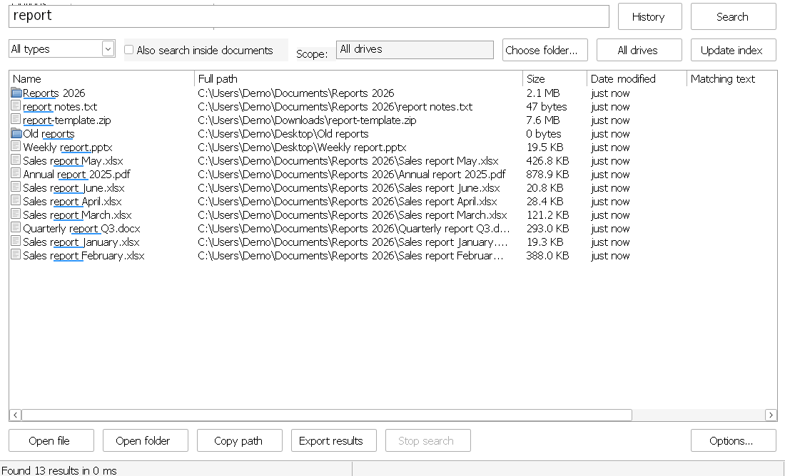
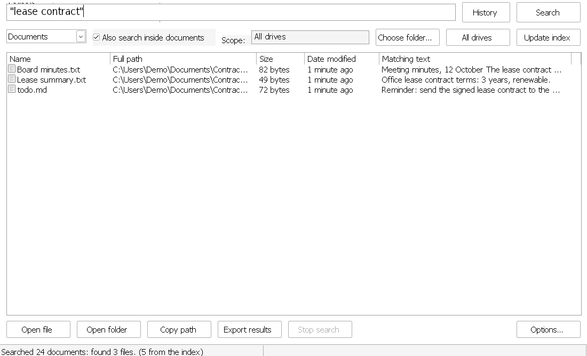

<div dir="rtl">

<p align="center"></p>

<h1 align="center">InstaFind — بحث سريع</h1>

<p align="center"><b>أسرع طريقة لإيجاد أي ملف على ويندوز، بالعربية والإنكليزية، وحتى داخل المستندات.</b></p>

<p align="center">
<a href="https://github.com/sarmadiq9090-coder/arabic-file-search/releases/latest"></a>
<a href="https://github.com/sarmadiq9090-coder/arabic-file-search/releases"></a>
<a href="https://github.com/sarmadiq9090-coder/arabic-file-search/actions/workflows/build.yml"></a>
<a href="LICENSE"></a>
</p>

<p align="center">
<a href="https://github.com/sarmadiq9090-coder/arabic-file-search/releases/latest/download/bahth.exe"><b>⬇ تنزيل bahth.exe</b></a> ·
<a href="CHANGELOG.md">سجل التغييرات</a> ·
<a href="README.en.md">English</a>
</p>

<p align="center">


</p>

برنامج مجاني ومفتوح المصدر مكتوب بلغة Rust. يفهرس كل أقراصك مرة واحدة ثم يُظهر النتائج أثناء الكتابة، حتى مع ملايين الملفات. يفهم العربية كما تُكتب فعلاً: «احمد» تجد «أحمد»، و«التقرير» تجد «تقرير.pdf»، و`hgjrvdv` المكتوبة بلوحة المفاتيح الخطأ تجد «التقرير».

## التنزيل والتشغيل

1. نزّل [`bahth.exe`](https://github.com/sarmadiq9090-coder/arabic-file-search/releases/latest/download/bahth.exe) من [أحدث إصدار](https://github.com/sarmadiq9090-coder/arabic-file-search/releases/latest). ملف واحد، لا يحتاج تثبيتاً.
2. ضعه في مجلد دائم، مثلاً `%LOCALAPPDATA%\Programs\Bahth\` (هذا المسار تستعمله إضافات `integrations/`)، ثم شغّله.
3. إن ظهر تحذير SmartScreen لأن الملف غير موقّع رقمياً: «مزيد من المعلومات» ← «تشغيل على أي حال».

أول تشغيل يفهرس الأقراص في الخلفية (دقيقة أو أكثر حسب عدد الملفات)، وبعدها يفتح البرنامج فوراً ويبقى الفهرس محدَّثاً وحده عند إضافة الملفات أو حذفها أو إعادة تسميتها.

- **التحديث تلقائي**: يتحقق البرنامج مرة يومياً من GitHub ويعرض تثبيت الإصدار الجديد بنقرة ثم يعيد التشغيل، ويمكن التحقق يدوياً من «خيارات…». من لديه 0.3.1 أو أحدث يصله كل تحديث وحده.
- **المتطلبات**: ويندوز 8 أو أحدث، 64 بت. البحث داخل الصور يحتاج ويندوز 10 أو 11 (وحزمة اللغة العربية في ويندوز لقراءة النص العربي).
- **الخصوصية**: كل شيء يبقى على جهازك. الاتصال الوحيد بالإنترنت هو التحقق من التحديثات على GitHub، والبحث من الهاتف مطفأ ما لم تشغّله.
- **بيانات البرنامج** في `%LOCALAPPDATA%\BahthSari\` (الفهرس والسجل والإعدادات)، وتفضيلاته في `HKCU\Software\BahthSari`. لإزالته: أطفئ «التشغيل مع ويندوز» من «خيارات…»، ثم احذف `bahth.exe` وذلك المجلد.

## المميزات

### البحث
- **نتائج فورية بالاسم** أثناء الكتابة في كل الأقراص أو في مجلد تختاره، مع فلاتر جاهزة: مستندات، صور، صوت، فيديو، مضغوطات، برامج، مجلدات.
- **عربية حقيقية**: لا فرق بين أ إ آ ا، ولا ة ه، ولا ى ي، ويتجاهل التشكيل والتطويل و«ال»، ويقبل الأرقام العربية (٠١٢٣) والحروف الفارسية.
- **يسامح الأخطاء**: إن لم يجد شيئاً جرّب وحده لوحة المفاتيح الأخرى، ثم الفرانكو (`3abd` ← عبد)، ثم الكلمات القريبة إملائياً (`تقريز` ← التقرير). و`جذر:` يبحث بجذر الكلمة.
- **صيغة بحث قوية**: عبارة بين علامتي تنصيص، «أو» و«ليس»، نوع الملف، الحجم، تاريخ التعديل، التعبيرات المنتظمة، الكلمة كاملة، والتقارب بين كلمتين. انظر [الجدول أدناه](#طريقة-البحث).
- **الملفات الأكثر فتحاً أولاً**، وخط تحت الجزء المطابق، وترتيب بالنقر على عنوان أي عمود.
- **سجل البحث والبحوث المحفوظة** (Ctrl+H).

### داخل الملفات
- **داخل المستندات**: docx وxlsx وxls وpptx وpdf وodt وods وrtf وdoc وtxt وcsv، ورسائل البريد eml وmsg، وكتب epub، وملفات البرمجة، مع مقتطف من النص المطابق.
- **داخل الصور وملفات PDF الممسوحة ضوئياً** بمحرك التعرف على النصوص المدمج في ويندوز، دون أي تنزيل.
- **داخل الملفات المضغوطة** zip و7z وtar وtar.gz، تُقرأ في الذاكرة دون فك ضغطها، مع حماية من الأرشيفات المفخخة.
- **فهرس دائم للمحتوى**: يُستخرج نص كل مستند مرة واحدة في الخلفية، فيصبح البحث داخل الملفات بعدها شبه فوري.
- **كل التطابقات** داخل الملف مع أرقام الأسطر (F4)، وتصحيح العربية المعكوسة في ملفات PDF.

### أدوات
- **Ctrl+Alt+F** يُظهر البرنامج من أي مكان، و**Ctrl+Alt+G** في نافذة «حفظ» أو «فتح» بأي برنامج ينقلها إلى مجلد النتيجة التي تختارها.
- **الملفات المكررة**: يجدها بالحجم ثم بصمة المحتوى، ويعرض المساحة المهدرة، وينقل ما تختاره إلى سلة المحذوفات.
- **أحجام المجلدات**: عمود الحجم يشمل المجلدات، ونافذة تبيّن ما يملأ القرص.
- **عرض المصغرات** للصور والمستندات (Ctrl+T).
- **استبدال نص في عدة ملفات نصية** مع معاينة ونسخة احتياطية وزر تراجع.
- **البحث من الهاتف** عبر شبكة المنزل: مطفأ افتراضياً، برمز دخول، وللقراءة فقط.
- **سحب النتيجة وإفلاتها** في واتساب أو البريد أو Word، وCtrl+C ينسخ الملف نفسه، وF2 لإعادة التسمية، وDelete إلى سلة المحذوفات.
- **تصدير النتائج** إلى CSV يفتحه Excel بالعربية.
- **سطر الأوامر** و**إضافة Flow Launcher** وأمثلة PowerShell وAutoHotkey.

### الراحة
- **واجهة عربية أو إنكليزية**: تتبع لغة ويندوز، وتُغيَّر من «خيارات ← Language / اللغة».
- **يعمل مع ويندوز** في الخلفية، وEsc يخفيه إلى شريط المهام، ونسخة واحدة فقط منه.
- تواريخ نسبية («أمس»، «قبل 5 دقائق»)، وخيار الأرقام العربية، وأيقونات أنواع الملفات.
- أي خطأ داخلي يُسجَّل في `log.txt` و`crash.txt` ولا يُغلق البرنامج.

## طريقة البحث

| تكتب | المعنى |
|---|---|
| `تقرير المبيعات` | الاسم يحتوي الكلمتين معاً |
| `"تقرير المبيعات"` | العبارة كما هي |
| `تقرير .pdf` أو `ext:pdf` أو `*.pdf` | ملفات PDF فقط، و`ext:docx,xlsx` لأكثر من نوع |
| `صورة\|فيديو` | إحدى الكلمتين |
| `عقد !قديم` أو `عقد -قديم` | استبعاد ما يحتوي «قديم» |
| `مجلد:` أو `folder:` | المجلدات فقط |
| `حجم:>10م` أو `size:>10mb` | أكبر من 10 ميغابايت (`ب` `ك` `م` `ج` أو `b` `kb` `mb` `gb`)، و`size:1mb..5mb` بين حجمين |
| `حجم:فارغ` `صغير` `متوسط` `كبير` `ضخم` | أحجام جاهزة (`empty` `tiny` `small` `medium` `large` `huge` `gigantic`) |
| `تاريخ:اليوم` `أمس` `هذا_الأسبوع` `هذا_الشهر` `هذه_السنة` | حسب تاريخ التعديل (`dm:today` `yesterday` `thisweek` `thismonth` `thisyear`) |
| `dm:2024-05` أو `dm:>2024-01-01` أو `dm:7d` | شهر معيّن، أو بعد تاريخ، أو آخر 7 أيام (`3w` `2m` `1y`) |
| `regex:^IMG_\d+` | تعبير منتظم على الاسم (أو النص داخل المستندات) |
| `كلمة:عقد` أو `ww:عقد` | الكلمة كاملة: «عقد» لا «العقود» |
| `"عقد إيجار"~5` | الكلمتان وبينهما 5 كلمات على الأكثر |
| `تقريب: تقريز` أو `fuzzy:` | يتحمّل خطأً إملائياً أو خطأين |
| `فرانكو: 3abd` أو `franco:` | الحروف اللاتينية تُقرأ عربية |
| `جذر: كتاب` أو `root:` | «مكتبة» و«الكاتب» و«كتابات» |

للبحث داخل المستندات فعّل «البحث داخل المستندات أيضاً» ثم اضغط Enter. فلاتر الحجم والتاريخ تعمل في الحالتين، والأرقام العربية مقبولة في كل الفلاتر.

## لوحة المفاتيح

| المفتاح | العمل |
|---|---|
| Ctrl+Alt+F | إظهار البرنامج أو إخفاؤه من أي مكان |
| Ctrl+Alt+G | في نافذة حفظ أو فتح: الانتقال إلى مجلد نتيجة |
| Enter / Ctrl+Enter | فتح الملف / فتح مجلده مع تحديده |
| السهم للأسفل | من مربع البحث إلى النتائج (وفي مربع فارغ: السجل) |
| Ctrl+C / Ctrl+Shift+C | نسخ الملف نفسه / نسخ المسار |
| F2 / Delete | إعادة التسمية / النقل إلى سلة المحذوفات |
| F4 | كل التطابقات داخل الملف |
| Ctrl+H | السجل والبحوث المحفوظة |
| Ctrl+T | عرض المصغرات |
| Ctrl+F / Esc | العودة إلى مربع البحث / مسح البحث ثم الإخفاء |

## سطر الأوامر والتكامل

نفس `bahth.exe` يبحث من موجّه الأوامر بنفس الصيغة ومن الفهرس المحفوظ (افتح البرنامج مرة لبنائه):

```
bahth.exe -s "فاتورة ext:pdf"
bahth.exe -s تقرير -n 20 --sort date --desc --scope "D:\العمل"
bahth.exe -s عقد --json
```

الخيارات: `-n`/`--max`، و`--sort name|path|size|date` مع `--desc`، و`--scope`، و`--count`، و`--csv`، و`--json`، و`--help`. رمز الخروج 0 عند وجود نتائج، و1 عند عدمها، و2 عند الخطأ.

إضافة Flow Launcher جاهزة (اكتب `ب فاتورة`) وأمثلة PowerShell وAutoHotkey وWindows Terminal في [`integrations/`](integrations/).

## ملاحظات

- قراءة النص من الصور أبطأ من المستندات، وتحتاج حزمة لغة ويندوز لكل لغة (الإعدادات ← الوقت واللغة ← إضافة لغة). يُفحص أول 50 صفحة من كل PDF ممسوح، والصور الأكبر من 30 ميغابايت تُتجاهل.
- دعم ملفات doc القديمة تقريبي.
- المشاكل والاقتراحات مرحّب بها في [Issues](https://github.com/sarmadiq9090-coder/arabic-file-search/issues)، ويفيد إرفاق `%LOCALAPPDATA%\BahthSari\log.txt`.

## للمطوّرين

البناء من المصدر وخريطة الكود وطريقة النشر في [docs/DEVELOPMENT.md](docs/DEVELOPMENT.md). باختصار: `cargo build --release` على ويندوز، و`cargo test` يعمل على لينكس أيضاً.

## الرخصة

[MIT](LICENSE)

</div>
