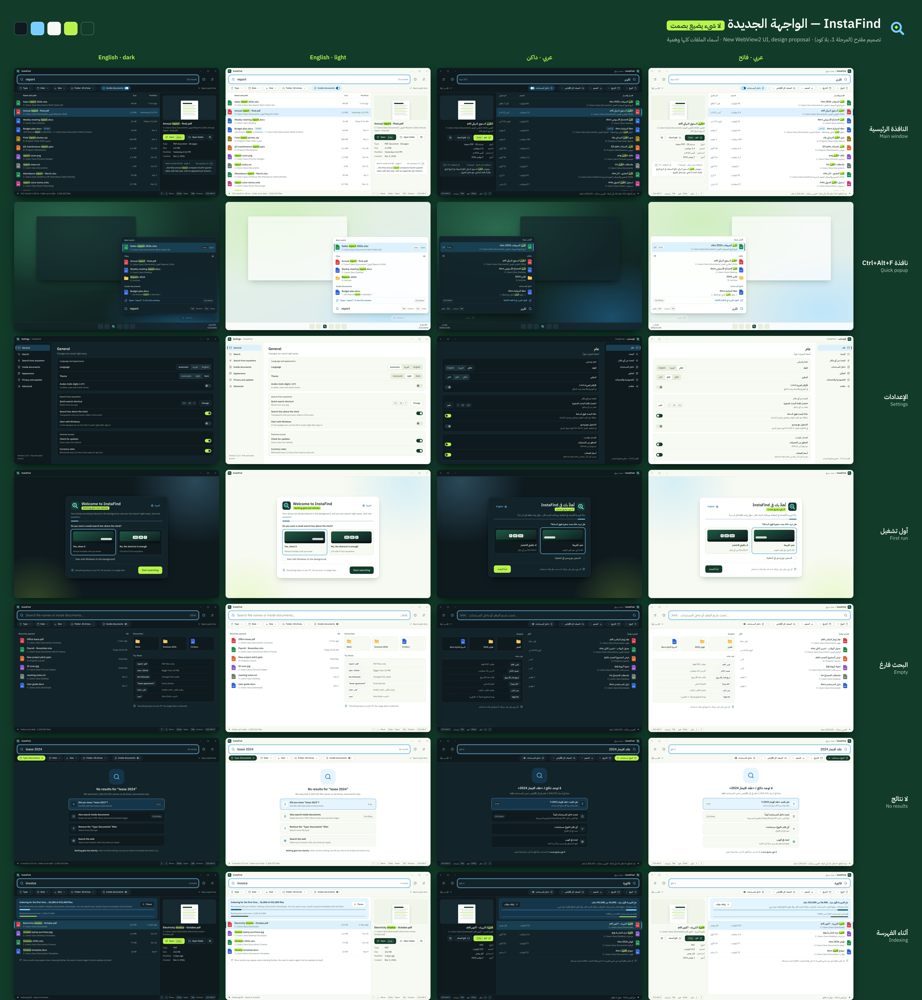

<div dir="rtl">

# الواجهة الجديدة لـ InstaFind (المرحلة 1: تصميم فقط)

قال المالك إن الواجهة الحالية «تبدو قديمة بعشر سنوات»، واختار واجهة جديدة كاملة مبنية على WebView2.
هذا المجلد هو **التصميم والخطة فقط**. لا يغيّر سطراً من كود البرنامج ولا رقم الإصدار.

<p align="center"></p>

| الملف | ماذا فيه |
|---|---|
| [`council.md`](council.md) | مراجعة المجلس: سبع زوايا (تجربة الاستخدام، الشكل، المستخدم العربي، المستخدم المحترف الأجنبي، الاختبار، الأمان، الأداء)، وما نحتفظ به، وما نصلحه، ودروس من Everything وListary وبحث ويندوز وPowerToys |
| [`architecture.md`](architecture.md) | كيف تُبنى: محرك Rust كما هو، والواجهة في wry/tao (WebView2)، والاتصال بينهما، وميزانيات السرعة، والبديل حين لا يوجد WebView2، وإمكانية الوصول، والأسماء المجمّدة، والانتقال إلى MSVC |
| [`plan.md`](plan.md) | الخطة دفعةً بدفعة: ميزة واحدة في كل دفعة، والواجهة الجديدة مع إطلاق المتجر في دفعة 4 ديسمبر |
| [`preview-instafind-ui.png`](preview-instafind-ui.png) | لوحة المعاينة (دقة مضاعفة 2×) |
| [`shots/`](shots/) | 28 صورة بحجم 1280×800: سبع شاشات × عربي/إنجليزي × فاتح/داكن |
| [`mockups/`](mockups/) | النموذج التفاعلي: افتح `mockups/index.html` في المتصفح. اكتب في خانة البحث، والأسهم تنقل التحديد، وCtrl+Alt+F يفتح النافذة الصغيرة، والشريط السفلي يبدّل الشاشة واللغة والمظهر |

## الشاشات

1. **النافذة الرئيسية**: خانة بحث كبيرة، ورقائق فلاتر (النوع، التاريخ، الحجم، المجلد، «داخل المستندات»)، وقائمة نتائج بسطرين (الاسم، ثم المسار الكامل من اليسار لليمين حتى داخل الواجهة العربية) مع الحجم والتاريخ، ولوحة معاينة فيها مقتطف النص المطابق.
2. **نافذة Ctrl+Alt+F الصغيرة**: تبقى فوق الساعة كما يعرفها المستخدمون اليوم، وخانة الكتابة في أسفلها، والنتائج مجمّعة (أفضل نتيجة، ملفات، داخل المستندات).
3. **الإعدادات**: صفحة واحدة مقسّمة، تُحفظ فوراً، وفيها مفاتيح الاتصال بالإنترنت (التحديثات وأسعار العملات) ظاهرة.
4. **أول تشغيل**: سؤال واحد فقط (خانة البحث فوق الساعة: نعم/لا) و«التشغيل مع ويندوز» غير مفعّل، كما في PR #34، والفهرسة تبدأ فوراً في الخلفية.
5. **البحث الفارغ، ولا نتائج، وأثناء الفهرسة**: لا شاشة فارغة صامتة أبداً. هذا معنى «لا شيء يضيع بصمت».

## الهوية

ألوان FastKiwi v2: أخضر الغابة `#123B2A`، وليموني الكيوي `#B9F34A`، والأبيض الدافئ `#F7FAF2`، ولون InstaFind الخاص أزرق السماء `#78CFFF`.
الخطوط: IBM Plex Sans وIBM Plex Sans Arabic (ترخيص OFL، النسخ المحلية في `mockups/fonts/` مع ملفي الترخيص، ولا رابط لأي CDN).
الرمز المقترح: مربع أخضر غابة، فيه عدسة زرقاء، وفي وسطها نقطة ليمونية على شكل معيّن (نقطة الخط العربي، علامة عائلة FastKiwi) تعني «الشيء الذي كنت تبحث عنه». لم يُستبدل ملف الأيقونة الحالي: هذا قرار للمالك.

كل أسماء الملفات والمجلدات في الصور وهمية.

## إعادة توليد الصور

```sh
cd docs/ui-redesign/mockups
node render.cjs ../shots 1     # 28 صورة بدقة 1×، ويفشل إن ظهر خطأ أو طلب شبكة أو تجاوز أفقي
node render.cjs <مجلد> 2       # نفس الصور بدقة 2× للوحة المعاينة
```

</div>

## English

Design only (phase 1) for InstaFind's new WebView2 UI. No app code changes and no version bump.
`council.md` holds the seven-lens review, `architecture.md` the wry/tao design, IPC, performance budgets, fallback, accessibility and the MSVC switch, and `plan.md` the train-by-train plan (new UI and Store launch on the Dec 4 train).
`mockups/index.html` is interactive (type, arrow keys, Ctrl+Alt+F, and a switcher for screen, language and theme). `shots/` has 28 PNGs (7 screens × ar/en × light/dark, 1280×800), and `preview-instafind-ui.png` is the 2× sheet.
Fonts are local IBM Plex Sans and IBM Plex Sans Arabic (OFL, licences included). All file names are synthetic.
